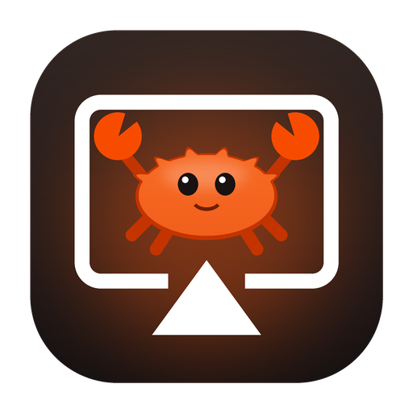
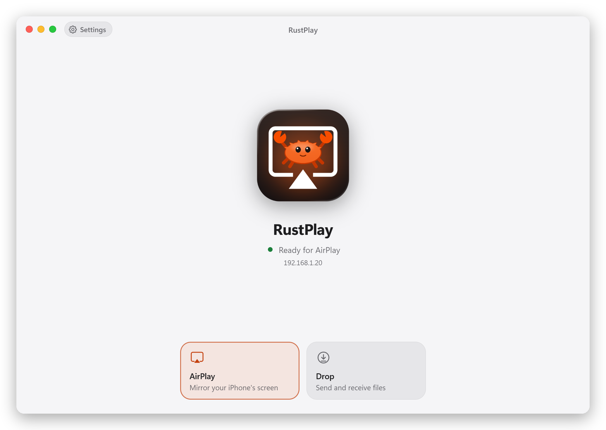
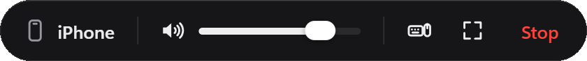
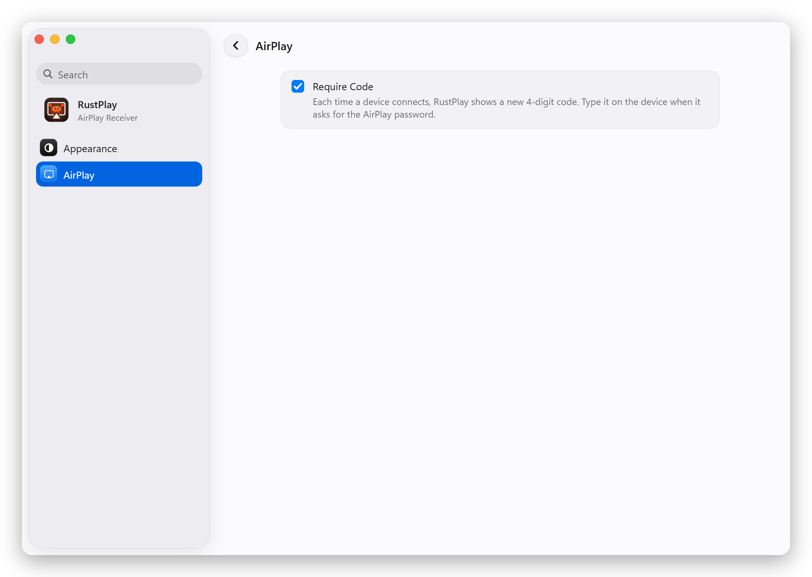
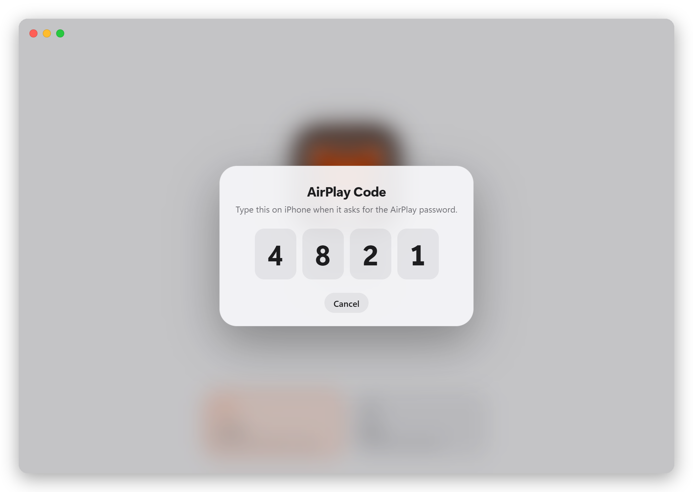
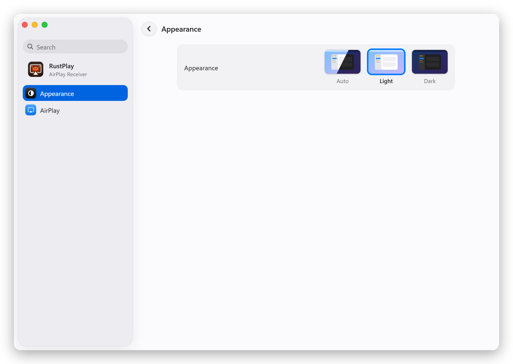
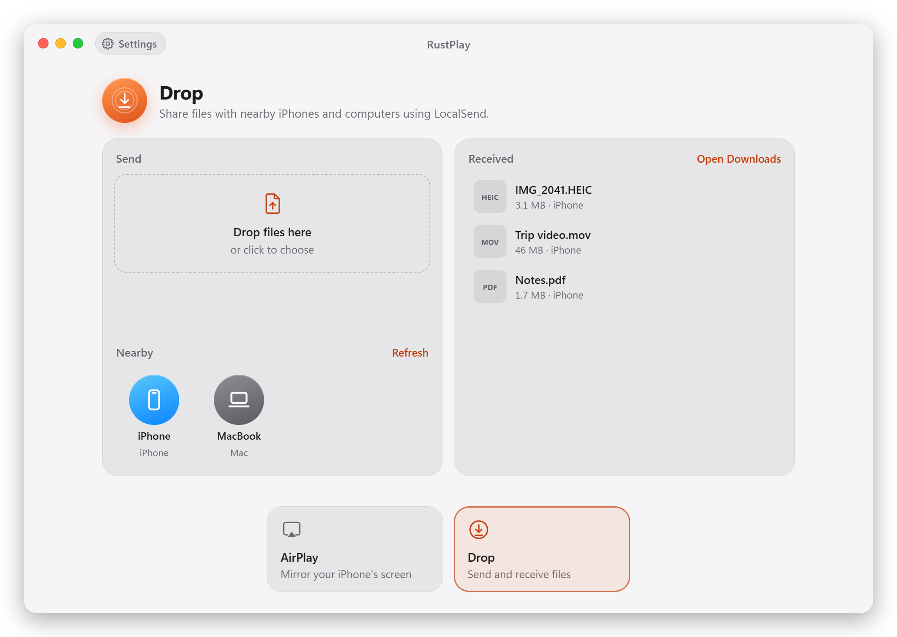

<p align="center">
  
</p>

<h1 align="center">RustPlay</h1>

<p align="center">
  <b>Mirror your iPhone or iPad to your Windows PC, with sound.</b><br>
  A free AirPlay receiver written in Rust, with an interface that feels at home next to your Apple devices.
</p>

<p align="center">
  <a href="https://github.com/Turtlemaxx/RustPlay/releases/latest"><b>⬇ Download for Windows</b></a>
  &nbsp;·&nbsp;
  <a href="#get-started">Get started</a>
  &nbsp;·&nbsp;
  <a href="#troubleshooting">Troubleshooting</a>
</p>

<p align="center">
  <a href="https://github.com/Turtlemaxx/RustPlay/releases/latest"></a>
  
  <a href="LICENSE"></a>
</p>

<p align="center">
  <picture>
    <source media="(prefers-color-scheme: dark)" srcset="docs/images/home-dark.png">
    
  </picture>
</p>

## What it does

| Feature | What you get |
| --- | --- |
| 📱 **Screen mirroring** | Shows your iPhone or iPad on your PC, with sound and a volume slider. |
| 🔒 **Connection code** | Optionally asks for a new 4-digit code each time a device connects. |
| 📁 **File sharing** | Sends and receives files through the free LocalSend app. |
| 🖱️ **Mouse and keyboard** | Controls your iPad with your PC's mouse and keyboard over Bluetooth (experimental). |
| 🌗 **Light and dark mode** | Follows Windows, or stays the way you choose. |

Everything stays on your own network. RustPlay has no account, and nothing goes through the cloud.

## Get started

1. **Download** `RustPlay-…-windows-x64.exe` from the [latest release](https://github.com/Turtlemaxx/RustPlay/releases/latest) and run it. There's nothing to install.
2. **Windows may warn you.** The exe isn't code-signed, so SmartScreen can show "Windows protected your PC". Click **More info**, then **Run anyway**.
3. **Allow the firewall prompt** on first launch, or your iPhone can't connect.
4. **On your iPhone or iPad**, open Control Center, tap **Screen Mirroring**, and choose **RustPlay**. Both devices have to be on the same network.

### What you need

- Windows 10 or 11, 64-bit, with the WebView2 runtime. It's built into Windows 11 and already on most Windows 10 PCs.
- An iPhone or iPad on the same network as the PC.
- For file sharing: the free [LocalSend](https://localsend.org) app on the other device.
- For mouse and keyboard: Bluetooth on the PC that can act as a mouse and keyboard. RustPlay tells you if yours can't.

## Important to know

> [!IMPORTANT]
> **Anyone on your network can start mirroring until you turn on Require Code.** It's off by default. If you use RustPlay on a shared network, turn it on in Settings.

> [!WARNING]
> **Anyone on your network with LocalSend can send you files.** Received files save straight to your Downloads folder without asking. Windows marks them as coming from the internet and warns before running them, but be careful with files you didn't expect.

> [!NOTE]
> **This isn't real AirDrop.** AirDrop needs an Apple-only Wi-Fi link that Windows Wi-Fi drivers don't offer, so file sharing uses LocalSend instead.

## Using RustPlay

### Mirroring

While you're mirroring, move the mouse to bring up the control bar:

<p align="center">
  
</p>

| To do this | Do this |
| --- | --- |
| Change the volume | Use the slider, scroll over the bar, or press ↑ / ↓. Your iPhone's volume buttons work too. |
| Mute | Click the speaker, or press M. |
| Go full screen | Click the full screen button, double-click the screen, or press F. Esc leaves full screen. |
| End mirroring | Click **Stop**. |
| Rename the receiver | Click the name under the icon. Your iPhone shows the new name within a few seconds. |

If your iPhone locks, mirroring pauses and picks up again when you unlock it.

### Require a code to connect

Click **Settings** at the top left (or press Ctrl+,), go to **AirPlay**, and check **Require Code**.

<p align="center">
  <picture>
    <source media="(prefers-color-scheme: dark)" srcset="docs/images/settings-code-dark.png">
    
  </picture>
</p>

Now each new connection gets a new 4-digit code on your PC. Your iPhone asks for an **AirPlay password**: that's where the code goes.

<p align="center">
  <picture>
    <source media="(prefers-color-scheme: dark)" srcset="docs/images/code-dark.png">
    
  </picture>
</p>

Each code works once. After three wrong tries RustPlay pauses for a few seconds, and the next try gets a new code.

### Light and dark mode

In Settings, go to **Appearance** and choose **Light**, **Dark** or **Auto**. Auto follows your Windows setting and is the default.

<p align="center">
  <picture>
    <source media="(prefers-color-scheme: dark)" srcset="docs/images/settings-appearance-dark.png">
    
  </picture>
</p>

### Send and receive files

Pick **Drop** in the boxes at the bottom of the window. RustPlay works as a [LocalSend](https://localsend.org) device, so it can trade files with the free LocalSend app on iPhone, Android, Mac and Linux.

<p align="center">
  <picture>
    <source media="(prefers-color-scheme: dark)" srcset="docs/images/drop-dark.png">
    
  </picture>
</p>

- **From your iPhone to the PC:** tap Share, choose LocalSend, then RustPlay. Files save to Downloads automatically, and text messages show up so you can copy them.
- **From the PC to your iPhone:** drop files on the window (or click to choose them), then click your iPhone under **Nearby**. LocalSend has to be open on the iPhone.

### Control your iPad with mouse and keyboard (experimental)

1. While mirroring, click the keyboard-and-mouse button in the control bar.
2. The first time, pair the PC on your iPad: go to Settings → Bluetooth and tap your PC's name.
3. Click the mirrored screen to take control. **Esc** gives your mouse and keyboard back, and so does switching to another window.

| PC key | Acts as on the iPad |
| --- | --- |
| Ctrl | ⌘ Command (so Ctrl+C copies) |
| Alt | ⌥ Option |
| Right Ctrl | Control |

Turning the button off, or closing RustPlay, disconnects the iPad so its on-screen keyboard comes back. The PC stays in the iPad's Bluetooth list as "Not Connected" and reconnects by itself the next time you turn the button on.

To disconnect, RustPlay switches the PC's Bluetooth off and on for a moment, because Windows offers no other way. It skips this if another Bluetooth device is connected, so your headphones don't drop. In that case, disconnect the iPad in its Bluetooth settings.

## Troubleshooting

| Problem | What to try |
| --- | --- |
| RustPlay doesn't appear under Screen Mirroring | Check that both devices are on the same network, and not on a guest network. Then check that Windows Firewall allows RustPlay. |
| It appears, but the iPhone can't connect | A firewall like Portmaster or a VPN like Mullvad may be blocking it. Allow incoming LAN connections for `rustplay.exe` there. |
| The iPhone asks for a password | Require Code is on. Type the 4-digit code shown on your PC. |
| "Port 53317 is in use" on the Drop page | The LocalSend desktop app is running on the PC. Quit it and restart RustPlay. |
| The window doesn't open | Install the [WebView2 runtime](https://developer.microsoft.com/microsoft-edge/webview2/) from Microsoft. |
| Opening RustPlay only brings a window forward | That's normal: one copy runs at a time. |

For anything else, RustPlay keeps a log of its last run at `%APPDATA%\app.rustplay.receiver\rustplay.log`. Your settings are in the same folder.

## Build from source

You need [Rust](https://rustup.rs) and the Visual Studio C++ build tools.

```bash
git clone https://github.com/Turtlemaxx/RustPlay.git
cd RustPlay
cargo run --release
```

The finished program is `target\release\rustplay.exe`. It's a single file with the interface built in, so you can copy it anywhere.

<details>
<summary><b>How it works</b></summary>

- `src/airplay/mdns.rs` advertises `_airplay._tcp` and `_raop._tcp` over Bonjour, and re-advertises when the receiver is renamed or the code is turned on or off.
- `src/airplay/rtsp.rs` handles the control connection on port 7000: `/info`, pairing, FairPlay, `SETUP`, volume and `TEARDOWN`.
- `src/airplay/pairing.rs` is legacy pairing (Ed25519 + X25519, AES-CTR).
- `src/airplay/code.rs` is the optional connection code: RFC 2617 digest authentication on the first `SETUP`, with a one-time code and limited guesses, like UxPlay's `-pw`.
- `src/airplay/fairplay.rs` runs the FairPlay handshake. The vendored C code in `vendor/playfair` decrypts the session key.
- `src/airplay/mirror.rs` decrypts the H.264 stream (AES-128-CTR) and survives the iPhone locking and reconnecting.
- `src/airplay/audio.rs` decrypts the audio (AES-128-CBC per RTP packet), decodes AAC-ELD with fdk-aac, and plays it through the default output with a ~70 ms jitter buffer.
- `src/drop.rs` runs Drop on LocalSend's own Rust core (`vendor/localsend-core`). That covers multicast discovery, the HTTPS server with certificate pinning, auto-accepting uploads into Downloads, and sending to devices under Nearby.
- `src/remote.rs` publishes a Bluetooth LE HID service (HID over GATT: a keyboard and a mouse report) through WinRT's `GattServiceProvider`, and turns the window's captured input into HID reports.
- `src/ui_socket.rs` streams video and status to the window over a token-protected localhost WebSocket, and takes commands back.
- `ui/` holds the interface. It decodes video with WebCodecs and animates with real spring physics (SwiftUI-style response and damping).
- `icons/draw_icon.py` draws the icon (Ferris the crab on an AirPlay screen) and the layers the UI uses for its parallax tile.

Drop uses LocalSend's port 53317. For testing, `RUSTPLAY_NAME="RustPlay Dev"` runs a second copy with its own name, device ID and settings, and `RUSTPLAY_HIDE=1` keeps its window hidden.

</details>

## License

RustPlay is licensed under the [GNU General Public License v3.0](LICENSE).

The protocol follows [UxPlay](https://github.com/FDH2/UxPlay). `vendor/playfair` is GPL-3.0 (see its LICENSE.md), so a distributed build of RustPlay falls under the GPL-3.0. fdk-aac comes with its own license (the Fraunhofer FDK AAC license). `vendor/localsend-core` is LocalSend's core library under the Apache License 2.0 (see its LICENSE and VENDORED.md).

RustPlay is an independent project and isn't affiliated with or endorsed by Apple. AirPlay, AirDrop, iPhone, iPad and Mac are trademarks of Apple Inc.
